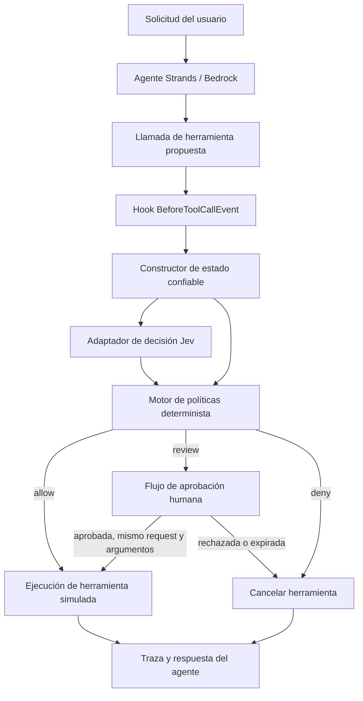

# Jev + Strands Decision Lab: ¿quién toma la decisión?

> El agente **propone**, Jev **evalúa**, las políticas **autorizan**.

> **🚀 Demo en vivo:** https://www.apps.strands-jev-demo.hazelsaenz.tech
> — agente real de Strands sobre Amazon Bedrock (Nova) + Jev real (TypeSafe AI,
> `jev-1.14.0`), desplegado en AgentCore Runtime + Amplify.

Un laboratorio educativo y reproducible que muestra cómo incorporar una **capa de
decisiones** a tus agentes. Un agente construido con [Strands Agents](https://strandsagents.com)
sobre Amazon Bedrock propone llamadas de herramienta; un adaptador de decisión
basado en [Jev (TypeSafe AI)](https://typesafe.ai) emite una señal consultiva; un
motor de políticas determinista autoriza o bloquea; y un ejecutor **simulado**
realiza solo las acciones permitidas.

La idea central del proyecto: **razonar no es autorizar**. Que un LLM responda con
seguridad no significa que tenga permiso.

## Por qué existe esta capa

Muchas arquitecturas de agentes mezclan cuatro responsabilidades distintas:

1. **Razonar** (el LLM interpreta la intención).
2. **Recomendar una decisión** (una señal probabilística de riesgo o ruta).
3. **Aplicar políticas** (autorización determinista).
4. **Ejecutar** (el efecto real).

Cuando se mezclan, una recomendación probabilística termina autorizando acciones
peligrosas. Aquí se mantienen separadas: la evaluación probabilística (Jev) y la
autorización determinista (políticas) son responsabilidades diferentes.

## Arquitectura



Detalle en [`docs/architecture.md`](docs/architecture.md).

## Requisitos

- Python 3.11 o superior.
- [uv](https://docs.astral.sh/uv/) para gestionar el entorno.
- **Nada más** para el modo offline: la demo corre sin AWS y sin clave de Jev.

## Instalación

```bash
git clone <este-repo>
cd jev-strands-decision-lab
uv sync
```

## Uso

### Demo de los tres caminos (allow / review / deny)

```bash
uv run decision-lab demo
```

Muestra, en orden:

1. Operador consulta el estado de pagos en staging → **ALLOW**.
2. Operador pide reiniciar pagos en producción sin aprobación → **REVIEW**;
   luego llega la aprobación exacta → **ALLOW**.
3. Un developer sin permiso pide reiniciar → **DENY**.

Las trazas estructuradas (JSONL) se emiten por `stderr`:

```bash
uv run decision-lab demo 2> traces.jsonl
```

### Evaluar el dataset de escenarios

```bash
uv run decision-lab evaluate
```

```
Escenarios: 22
Correctos:  22/22  (exactitud 100%)
Unsafe allows: 0  (ejecuciones donde se esperaba review/deny)
Latencia local P50: 0.01 ms  P95: 0.01 ms
```

> La latencia reportada es la del **motor local** (política + proveedor mock),
> no la de una llamada de red a Jev. Ver [`docs/benchmark-method.md`](docs/benchmark-method.md).

### Listar los escenarios etiquetados

```bash
uv run decision-lab scenarios
```

## Frontend de aprendizaje (Astro)

Hay una interfaz visual en [`web/`](web/) que dibuja el flujo agéntico como un
**diagrama de cajas clicables**. Al correr un escenario, las cajas se iluminan en
secuencia; al hacer clic en una, se abre el **código real** de esa etapa y su
entrada/salida. Habla con un backend HTTP que expone el mismo motor:

```bash
# Terminal 1 — backend (stdlib, sin dependencias nuevas):
uv run python -m decision_lab.server          # http://127.0.0.1:8000

# Terminal 2 — frontend Astro:
cd web && npm install && npm run dev           # http://localhost:4321
```

Detalle en [`web/README.md`](web/README.md).

## El motor de políticas (reglas deterministas en orden)

De [`02 - Decision Policies and States`], implementado en `src/decision_lab/policy.py`:

1. Herramienta desconocida o argumentos inválidos → **deny**.
2. Actor sin rol de confianza → **deny**.
3. Rol insuficiente para la herramienta → **deny**.
4. Fallo del proveedor (timeout / schema / señal desconocida) → **deny** (fail-closed).
5. El proveedor recomienda `reject` → **deny**.
6. Reinicio en producción sin aprobación vinculada → **review** (nunca ejecuta).
7. El proveedor recomienda `review`, o el riesgo supera el umbral → **review**
   (salvo que exista una aprobación humana válida y vinculada para esa acción).
8. En caso contrario → **allow**.

**Invariante de seguridad**: la señal de Jev puede *restringir* (pedir review o
deny), pero jamás *ampliar* lo que las reglas permiten. Un `execute` del proveedor
nunca convierte un rol sin permiso en una ejecución.

## Proveedores de decisión

- **`MockJevProvider`** (por defecto): determinista, sin red. Reproduce el
  *comportamiento* del pipeline, no las probabilidades reales de Jev.
- **`RealJevProvider`** (opcional): usa el SDK oficial `typesafe-sdk` detrás de
  `TYPESAFE_API_KEY`. Hace una pregunta `Choice` para la ruta y un `Noul` para el
  riesgo. Si no hay clave o SDK, el laboratorio cae al mock.

```bash
# Modo con Jev real (requiere clave y acceso de red):
uv sync --extra jev
export TYPESAFE_API_KEY=sk-...
```

## Modo live con el agente de Strands sobre Bedrock

El modo offline demuestra toda la capa de decisiones sin un LLM. Para correr el
agente real:

```bash
uv sync --extra strands   # o --extra live para Strands + Jev
export AWS_PROFILE=free-tier-Strands
export AWS_REGION=us-east-2
```

El agente se arma en `src/decision_lab/agent.py` con el modelo
`us.amazon.nova-pro-v1:0` (Amazon Nova) sobre el perfil `free-tier-Strands`
(región `us-east-2`, donde están los perfiles de inferencia de Nova) y el hook de
decisión conectado. Las herramientas siguen siendo simuladas: **nunca se toca
infraestructura real**.

## Qué está verificado y qué no

Este proyecto pasó una compuerta de investigación antes de escribir los
adaptadores. El detalle, con fuentes y nivel de confianza, está en
[`docs/references.md`](docs/references.md). En resumen:

- **Verificado de primera mano**: `strands-agents` 1.65.0 y la firma de
  `BeforeToolCallEvent` (`event.tool_use`, `event.cancel_tool`); el SDK oficial
  `typesafe-sdk` 0.7.5 y su API `TypeSafeClient().system_one(...)`.
- **Documentado por la comunidad (no de primera mano)**: el endpoint REST exacto
  de Jev.
- **No verificado — no se afirma como hecho**: el precio ($0.042/M tokens) y la
  latencia (~70–500 ms) de Jev. No se usan para calcular costos "reales".

El `RealJevProvider` está escrito contra el contrato verificado del SDK, pero
**no se ejecutó contra el servicio real** en este laboratorio (requiere clave).

## Pruebas

```bash
uv run pytest        # 53 tests
uv run ruff check .  # lint
uv run mypy src      # tipos (strict)
```

Pruebas de aceptación no negociables (en `tests/`):

- Un reinicio no autorizado nunca ejecuta, aunque Jev recomiende `execute`.
- Un reinicio en producción sin aprobación válida entra en `review`.
- Un timeout o respuesta malformada de Jev nunca ejecuta una herramienta.
- Una aprobación se vincula a herramienta y argumentos canónicos, expira y es de
  un solo uso (sin replay).
- La demo offline corre sin credenciales de nube.

## Estructura

```text
src/decision_lab/
  models.py        # tipos del dominio (DecisionState, DecisionSignals, PolicyOutcome)
  state.py         # constructor de estado confiable + aprobaciones (no-replay)
  policy.py        # motor de políticas determinista (la única autoridad)
  providers/
    base.py        # interfaz DecisionProvider + errores
    mock.py        # MockJevProvider determinista
    jev.py         # RealJevProvider (SDK typesafe-sdk)
  tools.py         # herramientas simuladas (inspect_service, restart_service)
  telemetry.py     # trazas JSONL con redacción
  pipeline.py      # orquestación proveedor→política→ejecución→traza
  steps.py         # pipeline instrumentado por pasos (para el frontend)
  demo_scenarios.py# los 3 escenarios guionados, reutilizables
  code_snippets.py # extrae el código real de cada etapa (inspect.getsource)
  hooks.py         # hook BeforeToolCallEvent de Strands
  agent.py         # agente Strands/Bedrock (modo live)
  evaluation.py    # carga y evalúa escenarios
  env.py           # carga mínima de .env sin dependencias
  server.py        # backend HTTP (stdlib) para el frontend local
  cli.py           # comandos demo / evaluate / scenarios
tests/             # test_policy, test_hook, test_providers, test_scenarios
examples/          # scenarios.json (22 escenarios etiquetados)
docs/              # architecture, references, demo-script, benchmark-method, articulo
web/               # frontend de aprendizaje (Astro): ciclo agéntico de cajas clicables
deploy/
  agentcore/       # entrypoint de AgentCore Runtime + requirements
  bridge/          # Lambda puente navegador → AgentCore
```

## Despliegue en AWS

El laboratorio está desplegado de verdad en AWS (cuenta `free-tier-Strands`,
`us-east-2`), con servicios reales de punta a punta:

```
Navegador (Astro en Amplify)
  → API Gateway HTTP API → Lambda jev-bridge
    → AgentCore Runtime (agente Strands + hook de decisión)
      → Bedrock Nova (razona y propone)
      → Jev real (TypeSafe AI, señal consultiva)
      → política determinista (autoriza)
  Secrets Manager: clave de Jev   ·   Route 53: dominio (cuenta aparte)
```

| Componente | Recurso |
|---|---|
| Agente | AgentCore Runtime `jevstrandsdemo` (Bedrock Nova) |
| Clave de Jev | Secrets Manager `jev-strands-demo/typesafe-api-key` |
| Puente navegador→agente | Lambda `jev-bridge` + API Gateway HTTP API (CORS) |
| Sitio | Amplify Hosting (app `jev-strands-demo`) |
| Dominio | `www.apps.strands-jev-demo.hazelsaenz.tech` |

### Cómo se despliega

- **Agente (AgentCore):** el entrypoint está en `deploy/agentcore/agent_runtime.py`
  (las 4 líneas de `BedrockAgentCoreApp` sobre el mismo código del laboratorio).
  Se despliega con el starter toolkit (`agentcore configure` → `agentcore deploy`).
  La clave de Jev se lee de Secrets Manager; los imports pesados son perezosos
  para no exceder el límite de 30 s de inicialización del runtime.
- **Puente (Lambda):** `deploy/bridge/lambda_function.py` recibe las peticiones
  del navegador e invoca el runtime con SigV4. Se usa API Gateway HTTP API (no
  Function URL) porque la cuenta puede bloquear Function URLs públicas.
- **Sitio (Amplify):** el FE de Astro se construye con `PUBLIC_API_BASE` apuntando
  al endpoint del puente y se sube a Amplify (`web/amplify.yml`).

### Notas aprendidas en el despliegue

- La clave válida de Jev tiene prefijo `apikey_` (una `vck_` dio 401).
- El agente **no fija `AWS_PROFILE`** en entornos gestionados (usan el rol de
  ejecución); el perfil local es opt-in con `DECISION_LAB_USE_AWS_PROFILE=1`.
- El DNS del dominio vive en otra cuenta: se crean solo registros nuevos.

> Las herramientas siguen siendo **simuladas** también en la nube: el despliegue
> demuestra la capa de decisiones, no toca infraestructura real.

## Limitaciones

- Las herramientas son simulaciones; esto **no** es un sistema listo para
  producción.
- El `ApprovalStore` es en memoria; una aprobación durable real usaría, por
  ejemplo, Step Functions + DynamoDB.
- Jev complementa las políticas; **no las reemplaza**. Las puntuaciones
  probabilísticas no son garantías de seguridad ni necesariamente están
  calibradas.

## Licencia

MIT.
