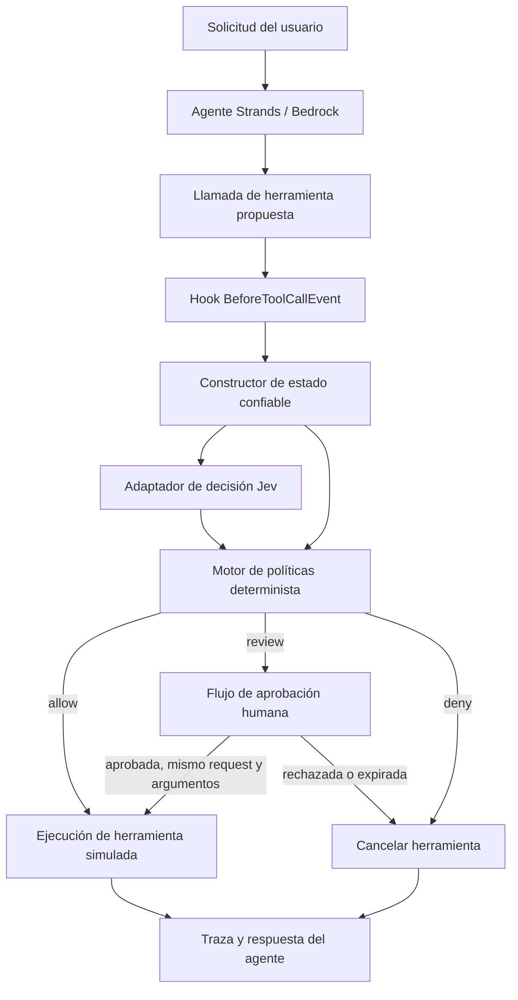
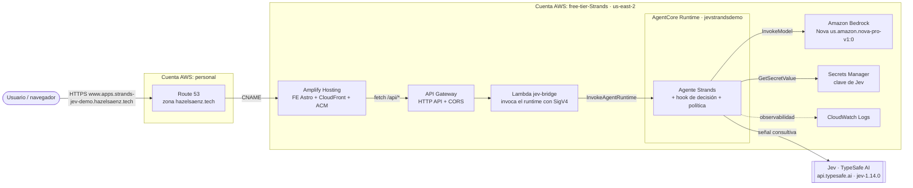

# Arquitectura

Dos vistas complementarias: el **flujo de decisión** (lógica del agente) y la
**infraestructura AWS** sobre la que corre desplegado.

## 1. Flujo de decisión (lógica del agente)



## 2. Infraestructura AWS (lo desplegado)



Mapeo lógico → infraestructura: el *agente* y el *hook/política* viven dentro del
**AgentCore Runtime**; el *adaptador de Jev* llama a **api.typesafe.ai**; el
modelo es **Bedrock Nova**; el navegador llega por **Amplify → API Gateway →
Lambda**. Las herramientas son simuladas también en la nube: no se toca
infraestructura real.

## Responsabilidades

- **Strands**: interpreta la intención del usuario y *propone* llamadas de
  herramienta. No autoriza.
- **Constructor de estado confiable** (`state.py`): combina la herramienta y
  argumentos propuestos con la identidad autenticada, el rol, el entorno y los
  metadatos de aprobación verificados. **Nunca** acepta afirmaciones de rol o
  aprobación que vengan del prompt del usuario.
- **Adaptador Jev** (`providers/`): evalúa rutas candidatas o señales de riesgo;
  jamás autoriza por su cuenta.
- **Motor de políticas** (`policy.py`): valida permiso, allowlist de
  herramientas, entorno, aprobación y defaults seguros. Es la única autoridad.
- **Ejecutor** (`tools.py`): solo efectos simulados en el MVP.
- **Observabilidad** (`telemetry.py`): traza request ID, herramienta, entradas
  de decisión (redactadas), proveedor/versión, salida, regla de política,
  latencia y resultado.

## Contratos internos (independientes del formato de red de Jev)

Ver `src/decision_lab/models.py`: `DecisionState`, `DecisionSignals`,
`PolicyOutcome`. El resto del sistema solo habla estos tipos; el adaptador de
proveedor traduce el mundo externo a ellos. Esto evita acoplar la política al
esquema de respuesta de ningún proveedor.

## Máquina de estados de la decisión

```
RECEIVED → PROPOSED → EVALUATING → EVALUATED → POLICY_CHECKED
         → ALLOWED / WAITING_APPROVAL / DENIED → EXECUTING → COMPLETED / FAILED
```

- Timeout o respuesta inválida del proveedor: `EVALUATING → DENIED` (fail-closed).
- `WAITING_APPROVAL → ALLOWED` solo tras una aprobación autenticada, no expirada,
  vinculada a request ID + herramienta exacta + hash canónico de argumentos.
- Una acción distinta debe re-evaluarse.

## AWS (opcional)

Bedrock para el modelo; AgentCore Runtime o Lambda para el agente; DynamoDB para
el estado; Step Functions para aprobación durable; Secrets Manager para la clave
de Jev; CloudWatch/OpenTelemetry para trazas. **Local primero**: nada se
despliega ni genera gasto sin una decisión explícita del lector.
